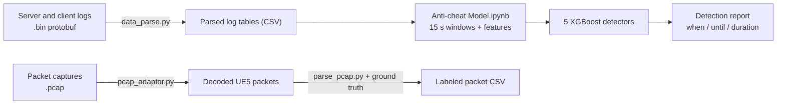

# AntiCheat with XGBoost

Detecting cheating in a multiplayer shooter built on **Unreal Engine 5 (UE5)**, using machine learning on **server/client game logs** and **network packet captures**.

This project turns raw data (binary protobuf logs and `.pcap` files) into tables, builds features over short time windows, and trains **XGBoost** classifiers that flag cheating players and say when the cheating happened.

---

## Table of Contents

1. [Overview](#overview)
2. [Pipeline](#pipeline)
3. [Dataset](#dataset)
4. [Method](#method)
5. [Results](#results)
6. [Getting Started](#getting-started)
7. [Command-Line Tools](#command-line-tools)
8. [Project Structure](#project-structure)
9. [What Is Not Included](#what-is-not-included)
10. [Known Limitations](#known-limitations)
11. [Authors](#authors)

---

## Overview

The data contains five kinds of cheats. Two are detected from player behavior (how they shoot and move), and two from network behavior:

| Cheat | What it is | Signals used |
|---|---|---|
| **Aimbot** | Software aims for the player | Behavior: accuracy, headshot rate, shot count |
| **Wallhack** | Player can see enemies through walls | Behavior: accuracy, headshot rate, shot count |
| **HitRedirection** | Shots are redirected onto a target | Behavior: accuracy, blind-shot rate, hit distance |
| **LagSwitch** | Player deliberately cuts or delays their connection in short bursts | Network: ping (UDP/ICMP) statistics, movement updates |
| **FixedDelay** | Player adds a constant artificial delay to their connection | Network: ping (UDP/ICMP) statistics, movement speed |

The main output is a report listing, per match, when a cheat was detected, until when, and for how long.

---

## Pipeline



The `.pcap` tools (bottom row) are used for packet-level analysis and for building a labeled packet dataset. The main model notebook gets its network features from the ping measurements recorded in the client logs, not from the `.pcap` files.

---

## Dataset

The dataset is organized as sessions and matches. Each match has a `Server` folder and client folders, containing `.bin` logs and `.pcap` captures. Only the log data of `Session_1` and `Session_2` (9 matches) is used by the main notebook.

| | Count |
|---|---|
| Server log rows | 1,806,461 |
| Client log rows | 1,317,827 |
| Cheat start/stop events | 442 |
| Cheat windows (start paired with stop) | 226 |

| Cheat type | Windows | Share |
|---|---|---|
| LagSwitch | 91 | 40.3% |
| FixedDelay | 50 | 22.1% |
| Aimbot | 42 | 18.6% |
| HitRedirection | 23 | 10.2% |
| Wallhack | 20 | 8.8% |

The dataset itself is **not included** in this repository (see [What Is Not Included](#what-is-not-included)).

---

## Method

**Step 1: Parse the logs.** `data_parse.py` reads each binary `.bin` log with a ring-buffer protobuf parser into a table. It then flattens nested columns so that XGBoost can use them: dictionaries become `parent.child` columns, fixed-length lists become `col_0, col_1, ...`, variable-length lists become count/mean/min/max, and booleans become 0/1.

**Step 2: Label cheat periods.** Every `cheat` event has a cheater ID, a cheat type, and a start or stop flag. A start is paired with the next matching stop for the same player, giving 226 labeled cheat windows.

**Step 3: Build window features.** For every player, a **15-second window slides forward in 5-second steps**. Each window becomes one row of features:

- *Behavioral:* total shots, accuracy, blind-shot rate, headshot rate, average and maximum hit distance, movement count, average/maximum speed, speed standard deviation
- *Network:* movement features plus the mean, standard deviation, and maximum of the player's own UDP and ICMP ping, and of the whole match's ping

This gives 3,581 windows: 2,643 clean and 938 with at least one cheat.

**Step 4: Train one detector per cheat.** Each cheat has its own binary XGBoost model (`n_estimators=200`, `max_depth=4`, `learning_rate=0.1`, `subsample=0.8`, `colsample_bytree=0.8`). Because cheat windows are rare, **SMOTE** oversampling is applied to the training data only. Aimbot, Wallhack, and HitRedirection use the behavioral features; LagSwitch and FixedDelay use the network features.

**Step 5: Split by match.** To avoid leakage between windows of the same match, whole matches go to either training or testing:

| Split | Matches |
|---|---|
| Train | Session_1 Match_2–5, Session_2 Match1 |
| Test | Session_2 Match2–4 (1,457 windows) |

**Step 6: Report.** Detections with probability ≥ 0.5 are merged when they are close together, then printed as `CHEAT DETECTED: when / until / duration`. Models are saved as `model_<cheat>.json`.

---

## Results

Test set: 1,457 windows from Session_2 Match2–4. Scores are for the **cheat class**:

| Detector | Cheat windows in test | Precision | Recall | F1 |
|---|---|---|---|---|
| HitRedirection | 56 | 0.57 | 0.75 | **0.65** |
| LagSwitch | 130 | 0.18 | 0.42 | 0.25 |
| Aimbot | 103 | 0.12 | 0.13 | 0.12 |
| FixedDelay | 105 | 0.09 | 0.18 | 0.12 |
| Wallhack | 52 | 0.11 | 0.12 | 0.11 |

**How to read this:** the overall accuracy of each model (78–97%) looks high but is misleading. About 91–96% of test windows are clean, so a model that always answers "clean" would score almost the same. Only **HitRedirection** is detected reasonably well. The other four are close to chance, so this is a **preliminary result**, not a finished detector.

### Server-only experiment

`TKL_ServerOnly_model1.ipynb` explores what can be detected using **only server logs**. It builds one row per (time window, player) and adds features about the *other* players in the same window. A multi-label model (`MultiOutputClassifier` with XGBoost: 300 trees, depth 6, learning rate 0.05) predicts FixedDelay, DOS, HitRedirection, and Wallhack together, validated with `TimeSeriesSplit`. It uses a single match (Session_2 Match1) with only 2–17 positive windows per label, so it is exploratory.

---

## Getting Started

### Prerequisites

- Python 3 and Jupyter
- Libraries (there is no `requirements.txt` yet):

```bash
pip install jupyterlab xgboost pandas numpy scikit-learn imbalanced-learn matplotlib seaborn scapy
```

- The dataset and the `ParserProtobufLogs` package (see [What Is Not Included](#what-is-not-included))

### Run the main model

1. Place the dataset so the notebook can find it, or change `DATA_PATH` in the second code cell of `Anti-cheat Model.ipynb`.
2. Open `Anti-cheat Model.ipynb` in Jupyter and run the cells in order.
3. The notebook prints the per-cheat classification reports, saves `model_aimbot.json`, `model_wallhack.json`, `model_hitredir.json`, `model_lagswitch.json`, `model_fixeddelay.json`, and prints the detection report for the test matches.

### Parse raw logs

```bash
mkdir parsed_files
python data_parse.py
```

This finds every `dataset/**/Server/*.bin` file, parses them in parallel (4 processes), and writes one CSV per match into `parsed_files/` (the files are named `parse_<Session>_<Match>`, without an extension).

---

## Command-Line Tools

**`pcap_adaptor.py`** decodes UE5 packets from `.pcap` files into a CSV.

```bash
python pcap_adaptor.py <pcap file | directory | glob> [--output pcap_adaptor_out.csv] [--server-port 7777]
```

**`parse_pcap.py`** decodes the packets and joins them to the ground-truth log table. Each packet is matched by sequence number, acknowledged sequence number, or the nearest timestamp.

```bash
python parse_pcap.py <pcap file | directory | glob> \
    [--output pcap_mapped.csv] [--truth parsed_all_packets.csv] \
    [--server-port 7777] [--match-window-ms 50] [--no-bunches] [--no-events]
```

Columns that exist on both sides are kept with the prefixes `wire_` (from the `.pcap`) and `bin_` (from the log), so they can be cross-checked.

**Small helper scripts** (edit the path at the top of each file before running):

| Script | What it does |
|---|---|
| `pcap_stream.py` | Reads `.pcap` files with Scapy and computes simple per-packet features (inter-arrival time, rolling rate, jitter, rolling size deviation) |
| `main.py` | Plots outgoing packets per 100 ms for each client CSV, to compare traffic between players |
| `find_cheat.py` | Keeps only the rows with `event_type == "cheat"` from a server CSV |

---

## Project Structure

```
AntiCheat-with-XGBoost/
├── Anti-cheat Model.ipynb      # Main model: windows, features, 5 detectors, report
├── TKL_ServerOnly_model1.ipynb # Experiment: server-only multi-label model
├── data_parse.py               # .bin protobuf logs -> flattened CSV
├── pcap_adaptor.py             # .pcap -> decoded UE5 packets (CSV)
├── parse_pcap.py               # Join decoded packets with ground truth
├── pcap_stream.py              # Simple packet features with Scapy
├── main.py                     # Traffic plot per client
├── find_cheat.py               # Extract cheat events
├── README_Mond.md              # Short usage notes for the .pcap tools
└── UE5_python_dependencies/    # Python implementation of the UE5 network protocol
```

`UE5_python_dependencies/` contains the bit-level serialization, connection handshake, packet and bunch parsing, and replication code that `pcap_adaptor.py` uses to read UE5 traffic.

<!-- Add the source and license of UE5_python_dependencies here. -->

---

## What Is Not Included

These are listed in `.gitignore` or were never added, so you need to provide them yourself:

- **The dataset** (`dataset/`, `*.csv`, `*.7z`): the `.bin` logs, `.pcap` captures, and parsed CSV files
- **`ParserProtobufLogs/`**: the package with `RingBufferParser`, which `data_parse.py` imports
- **Trained models** (`model_*.json`): created by running the notebook
- `requirements.txt` and a license file

---

## Known Limitations

- **Small data.** Only 226 labeled cheat windows from 9 matches, so some detectors have too few examples to learn from.
- **Weak detectors.** Aimbot, Wallhack, FixedDelay, and LagSwitch score close to chance on unseen matches (see [Results](#results)).
- **Fixed thresholds.** The detection threshold is 0.5 for every cheat and is not tuned.
- **Hard-coded paths.** Several scripts and notebooks contain local paths (for example `Session_1/Match_1/...`) that must be edited before running.
- **Not reproducible from this repository alone**, because the dataset and the log parser are missing.

---

## Authors

- [Krit](https://github.com/KritMeesiri)
<!-- Add collaborators and the course or advisor here. -->
