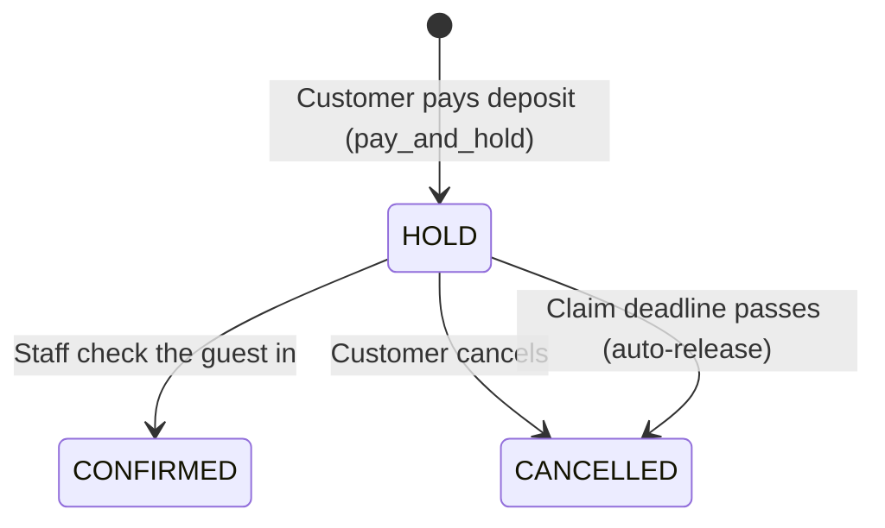

# BrewlyChillInSeat – Restaurant Table Reservation System

A web application for reserving restaurant tables, built with **PHP** and **MySQL** for the Database Programming Lab.
Customers reserve tables and pay a deposit, staff check guests in and manage their restaurant, and super admins manage the whole system.

The project focuses on **doing the important work inside the database**: business rules are enforced by triggers, multi-step actions run as stored procedures with transactions, and each user role connects with its own limited MySQL account.

---

## Table of Contents

1. [Features](#features)
2. [How a Reservation Works](#how-a-reservation-works)
3. [Tech Stack](#tech-stack)
4. [Getting Started](#getting-started)
5. [Project Structure](#project-structure)
6. [Database Design](#database-design)
7. [Background Jobs](#background-jobs)
8. [Known Limitations](#known-limitations)
9. [Authors](#authors)

---

## Features

**Customer**
- Register, log in, and edit a profile
- Browse restaurants, choose a party size, and pick tables
- Pay a deposit (Credit Card, PayPal, or QR code)
- View, check details of, and cancel reservations
- Receive in-app notifications (booked, checked in, cancelled, deadline reminder)

**Staff** (one restaurant per staff member)
- Dashboard and table layout with live table status
- Update reservation status and check guests in
- View customers and their reservations
- View reports: revenue, reservations by status, and daily revenue
- Update the restaurant's opening hours

**Super Admin**
- Add restaurants and users
- Manage which restaurant each staff member belongs to
- Reset user passwords
- View the activity log (login and logout history)

<!-- Add screenshots here, for example:


-->

---

## How a Reservation Works

Key terms used in this project:

| Term | Meaning |
|---|---|
| **Reservation** | A booking of one or more tables at a restaurant for a given date. The customer pages call this a "booking". |
| **HOLD** | The reservation is paid for and the tables are held, but the guest has not arrived yet. |
| **Claim deadline** | The latest time the guest can check in. It is the reservation date plus the restaurant's `claim_by_time` policy. |
| **Check-in** | Staff confirm the guest has arrived. The reservation becomes `CONFIRMED`. |



**Cancellation and refunds:** if a customer cancels *before* the claim deadline, the payment is marked `REFUNDED`. After the deadline there is no refund.

---

## Tech Stack

| Layer | Technology |
|---|---|
| Backend | PHP 8.x using `mysqli` (prepared statements in most queries) |
| Database | MySQL 5.7 (triggers, stored procedures, transactions, role-based users) |
| Frontend | HTML, CSS, and PHP-rendered pages |
| Scheduling | Windows Task Scheduler running PHP scripts |
| Development environment | MAMP on Windows |

---

## Getting Started

### Prerequisites

- A local web server with PHP 8.x and MySQL 5.7+ (this project was developed with [MAMP](https://www.mamp.info/))
- Access to MySQL as `root` (the stored procedures are created with `DEFINER=root@localhost`)

### Installation

1. **Create the database.** In phpMyAdmin (or the MySQL CLI), create an empty database named `project`.
2. **Import the schema and sample data.** Import `project.sql` into the `project` database. It creates 14 tables, 5 stored procedures, and 7 triggers.
3. **Create the role-based database users.** Run the SQL in `Database access control SQL.txt` (copy it into the SQL tab). This creates `customer_user`, `staff_user`, and `admin_user` and grants each one only the permissions it needs. Run this *after* step 2, because it grants access to tables and procedures that must already exist.
4. **Copy the app to your web root.** Copy the `project/` folder into your server's document root (for MAMP: `C:\MAMP\htdocs\`).
5. **Check the database settings.** Open `project/connect.php` and `project/cron_connect.php` and make sure the host and database name match your setup.
6. **Open the app.** Go to `http://localhost/project/login/login.php` (add your server's port if needed, e.g. `:8888`).

Sample users for each role are included in `project.sql` (see the `user` table).

To enable the automatic background jobs, follow [Background Jobs](#background-jobs).

---

## Project Structure

```
Database Programming Lab Project/
├── project.sql                      # Database schema, procedures, triggers, sample data
├── Database access control SQL.txt  # Creates role-based MySQL users and permissions
├── Cron reminder.txt                # Notes on the scheduled jobs
└── project/
    ├── connect.php                  # DB connection (picks the DB user by login role)
    ├── cron_connect.php             # DB connection for background jobs
    ├── RunAllCrons_Every5Min.xml    # Windows Task Scheduler definition
    ├── login/                       # Login, logout, register
    ├── customer/                    # Customer portal
    ├── staff/                       # Staff portal
    ├── superadmin/                  # Super admin portal
    └── cron/                        # Background job scripts
```

---

## Database Design

### Tables

| Table | Purpose |
|---|---|
| `user` | All accounts; the `role` column is `CUSTOMER`, `STAFF`, or `ADMIN` |
| `staff`, `admin` | Link a user to a restaurant (staff) or to admin rights |
| `restaurant` | Restaurant details, opening and closing time, status |
| `area` | Seating areas of a restaurant (`INFRONT` or `BACKSIDE`) with a price |
| `table` | Individual tables with capacity and status (`AVAILABLE`, `OCCUPIED`, `UNAVAILABLE`) |
| `policy` | Per-restaurant rules: minimum age and the check-in (claim) time |
| `reservation` | A booking and its status (`HOLD`, `CONFIRMED`, `CANCELLED`) |
| `reservation_tables` | Links a reservation to the tables it holds (many-to-many) |
| `payment` | Deposit payment (`PENDING`, `PAID`, `REFUNDED`) and method |
| `checkin` | Records which staff member checked in which reservation, and when |
| `notification` | In-app messages (`BOOKED`, `CHECKIN`, `CANCELLED`, `REMINDER`) |
| `login_history`, `logout_history` | Audit trail used by the activity log |

### Triggers – rules enforced by the database

| Trigger | What it does |
|---|---|
| `reservation_day_guard` | Blocks reservations for past dates |
| `reservation_age_guard` | Blocks users younger than the restaurant's minimum age |
| `reservation_deadline_calc` | Calculates `claim_deadline_at` from the reservation date and the restaurant policy |
| `reservation_lock_deposit` | Prevents the deposit amount from being changed after creation |
| `reservation_booked_noti` | Creates a notification when a reservation is made |
| `reservation_checkin_noti` | Creates a notification when a reservation becomes `CONFIRMED` |
| `reservation_cancel_noti` | Creates a notification when a reservation is cancelled |

Because these rules live in the database, they still apply even if a request bypasses the PHP code.

### Stored procedures

| Procedure | What it does |
|---|---|
| `pay_and_hold` | Validates the selected tables, creates the reservation and payment, and holds the tables in one transaction |
| `cancel_reservation` | Cancels a reservation, refunds it if before the deadline, and frees the tables in one transaction |
| `release_expired_holds` | Cancels `HOLD` reservations past their deadline and frees their tables |
| `reset_tables_after_closing` | Sets occupied tables back to `AVAILABLE` one hour after the restaurant closes |
| `send_deadline_warning` | Sends a reminder for holds that expire within 30 minutes |

Procedures that change several tables use `START TRANSACTION` with an exit handler that rolls back on error, so a failure never leaves half-finished data.

### Access control

Each role connects to MySQL with a different account, chosen in `connect.php` from the logged-in user's role:

| Role | MySQL user | Access |
|---|---|---|
| Customer | `customer_user` | Read restaurant data; read and write own reservations, payments, and notifications |
| Staff | `staff_user` | Manage reservations, tables, and check-ins of their restaurant |
| Admin | `admin_user` | Full management of the system |

This adds a second layer of protection on top of the checks in the PHP code.

---

## Background Jobs

Some tasks must run even when nobody is using the website. A batch file (`project/cron/run_holds.bat`) runs three PHP scripts every 5 minutes:

| Script | Purpose |
|---|---|
| `release_expired_holds.php` | Cancels expired holds and returns the tables to `AVAILABLE` |
| `reset_tables_hourly.php` | Resets table status one hour after the restaurant closes |
| `send_deadline_warnings.php` | Reminds customers whose hold is about to expire |

Output is appended to `project/cron/cron_holds.log`.

**To set it up (Windows):**

1. Open `project/cron/run_holds.bat` and change the PHP path and project path to match your computer. They are currently set for `C:\MAMP\...`.
2. Open **Task Scheduler** and choose **Import Task…**, then select `project/RunAllCrons_Every5Min.xml`.
3. Check that the task's action points to your edited `run_holds.bat`.

Task Scheduler is the Windows equivalent of a cron job. On Linux or macOS, use `cron` to run the same three PHP scripts.

---

## Known Limitations

- **Passwords** are stored as unsalted SHA-256 hashes. A production system should use PHP's `password_hash()` and `password_verify()`.
- **Database credentials** are written directly in `connect.php`, `cron_connect.php`, and the access control SQL. They are for local development only. Change them and move them out of source control before any real deployment.
- **Background jobs** are set up for Windows and MAMP paths and need manual changes on other systems.
- **Payments** record the payment method and status only; no real payment gateway is connected.

---

## Authors

- [Krit](https://github.com/KritMeesiri)
<!-- Add teammates and course/instructor information here -->
