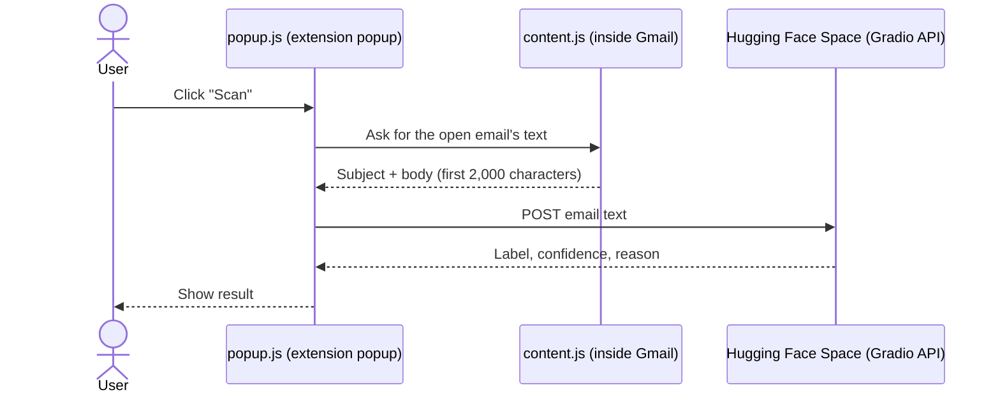

# Maily Detector – Gmail Spam, Phishing & Subscription Detection

A Chrome extension that checks the email you have open in Gmail and tells you whether it is **NOT SPAM**, **SPAM**, or a **SUBSCRIPTION** email.
The classification is done by a fine-tuned **DistilBERT** model (with **LoRA**) hosted on Hugging Face Spaces.

> Group 10 project. The extension scans only when you click the button; it never reads or changes your inbox in the background.

---

## Table of Contents

1. [Features](#features)
2. [How It Works](#how-it-works)
3. [The Model](#the-model)
4. [Getting Started](#getting-started)
5. [Project Structure](#project-structure)
6. [Privacy](#privacy)
7. [Known Limitations](#known-limitations)
8. [Team](#team)

---

## Features

- **One-click scan** of the email currently open in Gmail
- **Clear result**: a colored label, a confidence bar, and a short reason
  - Green: NOT SPAM
  - Red: SPAM
  - Blue: SUBSCRIPTION, with step-by-step instructions for cancelling a subscription
- **Language warning**: if more than 30% of the email is Thai, the extension warns that the model was trained on English only. You can still choose *Scan Anyway*.
- **Friendly errors** when no email is open, Gmail is not the active tab, or the model server cannot be reached

<!-- Add screenshots here (the final presentation PDF has the popup states), for example:


-->

---

## How It Works



| Component | Role |
|---|---|
| `content.js` | Runs inside `mail.google.com`. Reads the subject and body of the open email from the page. |
| `popup.js` / `popup.html` | The popup UI. Sends the text to the model server and displays the result. |
| Hugging Face Space | Runs the DistilBERT classifier behind a Gradio REST API. The extension tries the newer `/gradio_api/call/predict` endpoint first and falls back to `/run/predict`. |

---

## The Model

| | |
|---|---|
| Base model | `distilbert-base-uncased` (a smaller, faster version of BERT) |
| Fine-tuning | LoRA (`r=8`, `alpha=32`, dropout 0.05) on the attention `q_lin` and `v_lin` layers |
| Task | 3-class sequence classification: `0 = NOT SPAM`, `1 = SPAM`, `2 = SUBSCRIPTION` |
| Input length | Up to 256 tokens |
| Training | 3 epochs, with class-weighted cross-entropy loss because the classes are imbalanced |

### Data

Three public Kaggle datasets were combined, then split 90% / 10% for training and validation (stratified):

| Source | Used for | Emails |
|---|---|---|
| [Spam Email Dataset](https://www.kaggle.com/datasets/jackksoncsie/spam-email-dataset) | NOT SPAM and SPAM | 5,728 |
| [SpamAssassin Email Classification](https://www.kaggle.com/datasets/ganiyuolalekan/spam-assassin-email-classification-dataset) | Extra NOT SPAM examples | 2,000 sampled |
| [Subscription Renewal and Cancellation](https://www.kaggle.com/datasets/mirzayasirabdullah07/subscription-renewal-and-cancellation-dataset) | SUBSCRIPTION | 120 |

The subscription dataset is a table of customer records, not emails. Each row was turned into a short email using message templates (renewal notices, receipts, billing updates).

Final dataset: 7,848 emails (6,360 NOT SPAM, 1,368 SPAM, 120 SUBSCRIPTION) → 7,063 for training and 785 for validation.

### Results (validation set, 785 emails)

Overall accuracy: **98.6%** (F1 = 0.986)

| Class | Precision | Recall | F1 | Support |
|---|---|---|---|---|
| NOT SPAM | 0.99 | 0.99 | 0.99 | 636 |
| SPAM | 0.96 | 0.96 | 0.96 | 137 |
| SUBSCRIPTION | 1.00 | 1.00 | 1.00 | 12 |

> **Read the SUBSCRIPTION row carefully.** It has only 12 validation samples, and they come from the same templates as the training data, so the perfect score does not show how well the model handles real subscription emails.

### Keyword rules in the notebook's prediction function

After the model predicts, the notebook applies two simple rules:
- If the text contains words such as *subscription*, *billing*, *charged*, *plan*, *membership*, or *invoice*, the label is set to SUBSCRIPTION.
- For SPAM results, trigger words such as *free*, *win*, *click*, *urgent*, *money*, or *offer* are listed as the reason.

---

## Getting Started

### Option A – Try the extension

1. Download or clone this repository.
2. Open Chrome and go to `chrome://extensions`.
3. Turn on **Developer mode** (top-right corner).
4. Click **Load unpacked** and select the folder `maily-detector (upload this file to chrome extension then try it)`.
5. Open [Gmail](https://mail.google.com), click on an email to open it, then click the **Maily Detector** icon and press **Scan**.

The extension needs the Hugging Face Space to be running. If the Space is asleep or stopped, the scan fails with a connection error; try again after a minute.

### Option B – Retrain the model

1. Open `Spam_Mail_Detector_BERT(model source code).ipynb` in **Google Colab** and choose a GPU runtime.
2. Run the cells in order. **Cell 2** downloads the three datasets and asks you to upload your own `kaggle.json`: create it in your Kaggle account under *Settings → API*.
3. Training and evaluation take a few minutes on a GPU. The merged model is saved to `spam_classifier_merged/`.
4. *Optional:* the Flask + ngrok cell exposes the model as a temporary API. It needs your own ngrok auth token.
5. *Optional:* the last cell zips the model so you can download it.

> Never commit API tokens (Kaggle, ngrok, Hugging Face) to the repository. Use Colab Secrets or upload them at run time.

---

## Project Structure

```
Maily_Detection/
├── maily-detector (upload this file to chrome extension then try it)/
│   ├── manifest.json     # Chrome extension config (Manifest V3)
│   ├── content.js        # Reads the open email from Gmail
│   ├── popup.html        # Popup layout and styling
│   └── popup.js          # Calls the model API and shows the result
├── Spam_Mail_Detector_BERT(model source code).ipynb   # Data prep, training, evaluation
├── Group10 SRS_Template.pdf                            # Software Requirements Specification
├── Group10 SDS_Template.docx.pdf                       # Software Design Specification
└── Maily Detector Final Presentation.pdf               # Final presentation slides
```

The Gradio app that runs on Hugging Face Spaces is deployed separately and is not part of this folder.

---

## Privacy

- The extension only reads an email **when you click Scan**.
- When you scan, the **subject and the first 2,000 characters of the body** are sent over HTTPS to the Hugging Face Space for classification. The email text therefore leaves your browser.
- The extension does not store emails or results, and it never modifies, moves, or deletes any email.
- Its permissions are limited to `activeTab` and `scripting`, plus access to `mail.google.com` and `*.hf.space`.

---

## Known Limitations

- **English only.** The model was trained on English emails; results on other languages (including Thai) may be wrong.
- **Plain text only.** Images, attachments, and HTML layout are not analyzed, and long emails are cut at 2,000 characters.
- **Depends on a free-tier Hugging Face Space**, which can go to sleep or be slow to respond.
- **Gmail only, in Chrome.** The extension reads Gmail's page structure, so a Gmail redesign could break it.
- **Small, synthetic SUBSCRIPTION class** (120 template-based examples), and the keyword rule can label an ordinary email as SUBSCRIPTION if it contains words like "plan" or "billing".
- **Cancellation steps are generic.** They are not specific to any service.
- The model **assists** the reader and does not replace judgment: do not click links in suspicious emails even if the result says NOT SPAM.

---

## Team

Group 10:

- Apichat Laohawan – UML, AI model training, API calling
- Krit Meesiri – User stories, user requirements, UI/UX, testing and debugging
- Apiwit Pengyuak – Presentation
- Pearanat Pipathanasiri – Presentation
- Panod Manodee – BPMN, presentation

<!-- Add course name and instructor here -->
